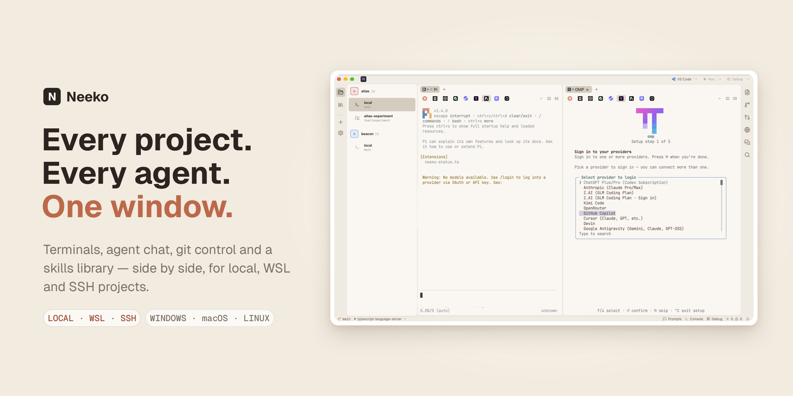
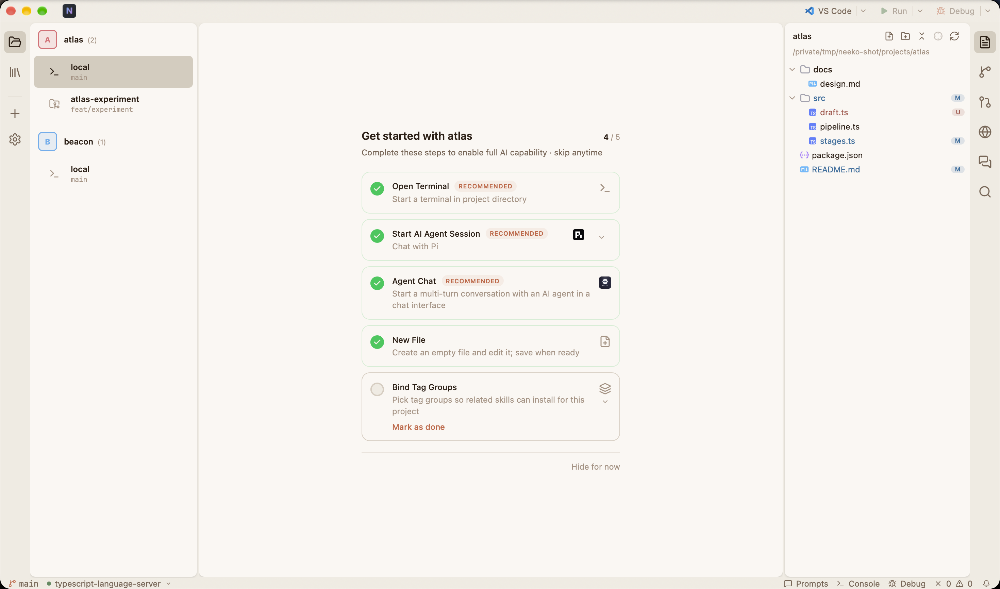
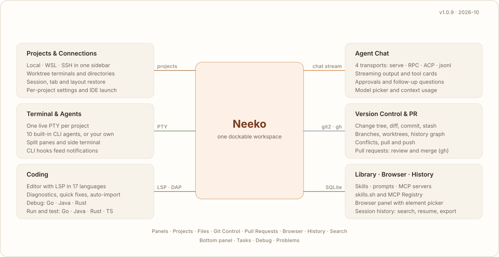

<div align="center">

# Neeko

**The AI-native workspace for multi-project development.**

One dockable window for terminals, AI agents, an editor, Git and pull requests — across local, WSL and SSH projects.




|                                                                              |                          |
| ---------------------------------------------------------------------------- | ------------------------ |
| [**Download**](https://github.com/tincopper/neeko/releases/latest) · English | **[简体中文](README_CN.md)** |

</div>

---

**Jump to** — [Why](#why-neeko) · [Preview](#preview) · [Capabilities](#capabilities) · [Comparison](#how-neeko-compares) · [Use cases](#use-cases) · [Install](#install) · [Platform](#platform-support) · [Develop](#develop) · [Docs](#documentation) · [Community](#community) · [License](#license)

---

## Why Neeko

Driving several projects with AI agents is a **coordination** problem, not a typing problem. The pain is never "I can't type the command" — it's *"which terminal was that agent in?"*, *"did my commit land?"*, *"the server copy of this repo is 400 files behind"*.

Neeko is a single workspace that solves those three things:

- **Sessions that survive.** Every project keeps its own live PTY. Switching projects, switching tabs or restarting the app never kills a running agent.
- **One context for code and chat.** Terminal, editor, diff view and agent conversation all point at the same working directory — no more hunting for the right tab.
- **Local, WSL and SSH behave the same.** A folder on a remote server gets the same panels, the same LSP, the same Git workflow as a local directory.

> **Not another terminal emulator.** Neeko is the layer *above* your editor and *around* your agents: it keeps them alive, keeps them visible, and keeps them pointed at the right project.

## Preview



<sub>  
Left: the project sidebar — each project, branch and worktree is a first-class entry. Right: the file tree, decorated with live Git status. Bottom: the status bar — branch, language server, panels, notifications.   </sub>

## Capabilities



### Projects & connections

- **Local, WSL and SSH projects** — one sidebar for local directories, WSL distributions and SSH hosts, browsed and mounted in place
- **Worktree sessions** — every git worktree gets its own terminal and working directory
- **Restart recovery** — project list, selected agent/IDE, worktree state and dock layout are restored
- **Sidebar upkeep** — drag to reorder, rename branches and worktrees inline, colour-code project avatars
- **Per-project settings** — override agent, IDE, appearance and tasks for a single project
- **Clone from Git** — pull a repository in with streaming progress

### Terminal & agents

- **One PTY per project** — switching projects or tabs never kills a running agent
- **10 built-in CLI agents** — Claude Code, OpenCode, Gemini, Codex, Qoder, CodeBuddy, OMP, Pi, Reasonix and Grok, with install detection and one-click launch
- **Custom agents** — add your own CLI with custom command, arguments and environment; override the built-ins; toggle chat capability per agent
- **CLI hooks** — 8 external CLIs (opencode, pi, omp, claude, codebuddy, qoder, codex, dsh) report their run state back into Neeko's notifications and status bar
- **Split panes & multi-tab** — split a terminal into panes and keep several tabs alive across projects
- **TUI theme sync** — the app theme is written into OpenCode and Pi config for local, WSL and remote projects

### Agent chat

- **Multi-agent chat** — talk to opencode, Pi or any ACP-speaking agent over 4 transports (opencode serve, Pi RPC, ACP, jsonl)
- **Streaming with tool cards** — reads, diffs, commands, todos, skills and plans render as reviewable cards
- **Approvals and follow-ups** — approve tool calls, answer questions, confirm plans
- **Models and context** — pick a model across providers and watch context usage
- **Session resume** — list past sessions and continue them on the agent side
- **Composer intelligence** — attachments, slash commands and `@` mention completion

<sub>A built-in MockAgent lets you try chat without installing any CLI.</sub>

### Coding

- **Files and editor** — project tree, multi-tab editing, untitled buffers, external-change detection
- **Editor groups** — split left/right, drag tabs between groups, pin a tab
- **Rich previews** — Markdown (GFM, mermaid, PlantUML), HTML, SVG, images and JSON
- **Navigation** — quick open, global search, symbol navigation, reference peek and a command palette
- **LSP for 17 languages** — Rust, Go, Python, TypeScript, JavaScript, Java, C, C++, C#, Ruby, PHP, Swift, Kotlin, Lua, Elixir, R, SQL
- **Diagnostics loop** — Problems panel, quick fixes, automatic import edit on completion accept
- **Semantic navigation** — go to definition, find references and hover, including virtual documents for Java sources
- **Custom servers** — register your own language server per file extension, with lifecycle policy and one-click install
- **Debug** — DAP breakpoints, stepping, variables and call stacks for Go, Java and Rust
- **Run & test** — launch entry points and run individual test cases for Go, Java, Rust and TypeScript
- **Unified console** — task output, LSP logs and Git operations share one console
- **AI translation** — translate comments block by block, or whole Markdown/HTML/TXT documents, using an agent you choose

### Version control

- **Change tree** — hierarchical file tree with status decoration, refreshed when files change on disk
- **Diff** — unified or side-by-side, syntax highlighting, word-level diff, change-block navigation
- **Commit and sync** — commit (message can be generated by an agent), push/pull, credential prompts
- **Branches & worktrees** — searchable branch switcher, create/rename/delete, worktree add/remove
- **Stash & conflicts** — stash management and conflict resolution
- **History and pull requests** — git graph, cherry-pick, tags; PR list, detail, review and merge through the `gh` CLI

### Library & signals

- **One library** — skills, prompts and MCP servers in a single searchable surface
- **Marketplaces** — install skills from skills.sh and MCP servers from the MCP Registry
- **Reusable prompts** — insert a prompt into the agent composer or the active terminal
- **Embedded browser** — open a page beside your code; the element picker copies the selected element's HTML to the clipboard
- **Session history** — scan agent session files, search them, resume or export
- **Notifications** — in-app notification centre plus desktop notifications (on macOS they jump back to the project)
- **Status bar** — branch, language server, problems, debug, conflicts, cursor position and notifications in one strip

<sub>5 built-in themes — Dark, Light, One Dark Pro, Claude and Classic Dark — plus custom theme files.</sub>

## How Neeko compares

Every team already has a terminal and an editor. The difference is whether they stay in sync while an agent works.

|                                                     |       **Neeko**      | Editor + terminal windows |  Shell-only CLI agents  |
| --------------------------------------------------- | :------------------: | :-----------------------: | :---------------------: |
| One PTY per project / branch / worktree, kept alive |           ✅          |             ❌             |        ⚠️ manual        |
| Agent run state visible outside the terminal        | ✅ status bar + hooks |             ❌             | ⚠️ terminal output only |
| Streaming agent chat with tool cards and approvals  |      ✅ built in      |    ❌ needs an extension   |        ⚠️ per-CLI       |
| Change tree, diff, commit, stash, PR review         |      ✅ built in      |       ⚠️ extensions       |    ❌ manual commands    |
| LSP diagnostics and DAP debugging                   |      ✅ built in      |      ✅ editor-native      |            ❌            |
| WSL and SSH projects in the same UI                 |           ✅          |    ⚠️ remote extensions   |      ⚠️ manual SSH      |
| Workspaces and layout survive a restart             |           ✅          |         ⚠️ partial        |            ✅            |

<sub>Neeko does not replace your editor or your agents — it becomes the desk they sit on.</sub>

## Use cases

- **Parallel agents on one repo** — one worktree per agent, each with its own terminal, chat surface and Git state.
- **Debug and test without leaving the editor** — DAP breakpoints, stepping, variables and call stacks for Go, Java and Rust, plus inline run and debug actions for Go, Java, Rust and TypeScript.
- **Remote development without the friction** — SSH into a build box and get the same panels, LSP and Git workflow you have locally.
- **WSL as a first-class target** — Linux toolchain, Windows desktop.
- **A personal AI control room** — one place to see which agent is running, what it changed, and what still needs a commit.

## Install

### Download

Grab the installer for your platform from [Releases](https://github.com/tincopper/neeko/releases/latest):

| Platform | Artifact                              |
| -------- | ------------------------------------- |
| Windows  | `.exe` (NSIS) or `.msi`               |
| macOS    | `.dmg` — drag Neeko into Applications |
| Linux    | `.AppImage` or `.deb`                 |

> **macOS first launch** — the build is unsigned. If macOS reports the app as damaged or unverifiable,  
> run `xattr -cr /Applications/Neeko.app` once and open it again.


There is no auto-updater: download a newer release to update.

### From source

Prerequisites:

- [Node.js](https://nodejs.org/) 24+
- [pnpm](https://pnpm.io/) 11+
- [Rust](https://rustup.rs/) 1.99+ — the exact toolchain is pinned in [`rust-toolchain.toml`](rust-toolchain.toml); `rustup` installs it automatically

Linux system packages:

```bash
# Ubuntu / Debian
sudo apt install -y build-essential libwebkit2gtk-4.1-dev libgtk-3-dev \
  libayatana-appindicator3-dev librsvg2-dev patchelf

# Fedora
sudo dnf install -y gcc gcc-c++ webkit2gtk4.1-devel libappindicator-gtk3-devel librsvg2-devel

# Arch
sudo pacman -S base-devel webkit2gtk-4.1 libappindicator-gtk3 librsvg
```

```bash
pnpm install
pnpm tauri dev      # development
pnpm tauri build    # packaged build
```

## Platform support

| Capability                                    | Windows | macOS      | Linux |
| --------------------------------------------- | ------- | ---------- | ----- |
| Local projects, terminals, editor, LSP, debug | ✅       | ✅          | ✅     |
| WSL projects                                  | ✅       | —          | —     |
| SSH remote projects                           | ✅       | ✅          | ✅     |
| Desktop notifications (click-through)         | ✅       | ✅ (native) | ✅     |
| Embedded browser panel                        | ✅       | ✅          | ✅     |

<sub>Language servers and debug adapters run from your own toolchain; Neeko detects them and can install the common ones.</sub>

## Develop

```bash
pnpm check:quick   # default gate: static checks + tests for the files you touched
pnpm check         # full local run (also executed by pre-push and CI)
```

- TDD is the working mode: failing test first, then the minimal implementation.
- Contribution flow, commit conventions and review rules: [CONTRIBUTING.md](CONTRIBUTING.md).
- Repository conventions for humans and AI agents: [AGENTS.md](AGENTS.md).

## Documentation

| Document                                                 | What it covers                                                                         |
| -------------------------------------------------------- | -------------------------------------------------------------------------------------- |
| [docs/features.md](docs/features.md)                     | The canonical capability inventory — the single source of truth this README summarises |
| [docs/ARCHITECTURE.md](docs/ARCHITECTURE.md)             | Module layout, DTO contracts and data flows                                            |
| [CONTEXT.md](CONTEXT.md)                                 | Domain glossary (project, worktree, agent, skill, task)                                |
| [docs/keyboard-shortcuts.md](docs/keyboard-shortcuts.md) | The full, remappable shortcut list                                                     |
| [CHANGELOG.md](CHANGELOG.md)                             | What changed in each release                                                           |
| [CONTRIBUTING.md](CONTRIBUTING.md)                       | How to contribute and what CI enforces                                                 |

## Community

- ⭐ If Neeko saves you time, [star the repository](https://github.com/tincopper/neeko) — it is the single most useful thing you can do for the project.
- [Issues](https://github.com/tincopper/neeko/issues) — bug reports and feature requests. Use the templates; they carry the details we need to reproduce.
- [Pull requests](https://github.com/tincopper/neeko/pulls) — see [CONTRIBUTING.md](CONTRIBUTING.md) for the quality gates your change has to pass.
- [Changelog](https://github.com/tincopper/neeko/blob/main/CHANGELOG.md) — what changed in each release.
- [Code of Conduct](https://github.com/tincopper/neeko/blob/main/CODE_OF_CONDUCT.md)

**Community group** — join the WeChat group to learn and discuss


## License

Apache 2.0 — see [LICENSE](LICENSE).
