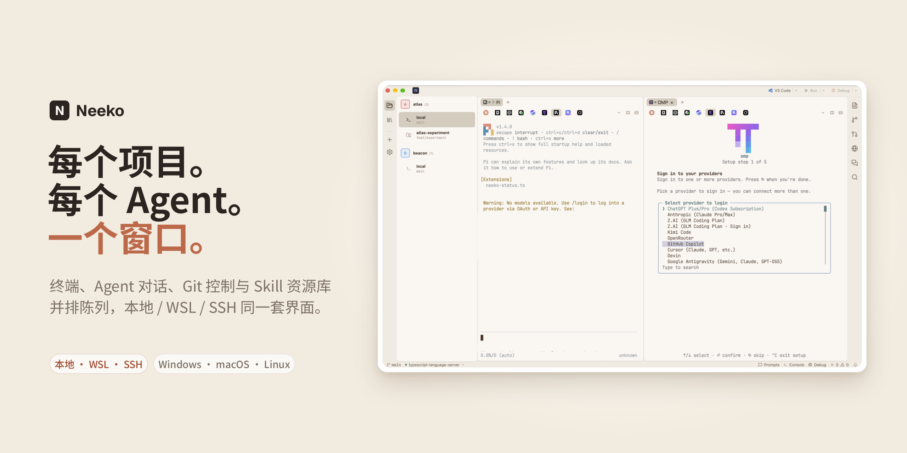

<div align="center">

# Neeko

**为多项目开发打造的 AI 原生工作台。**

终端、AI Agent、编辑器、Git 与 Pull Request 收进同一个可停靠窗口 —— 本地、WSL、SSH 项目统一管理。



<a href="https://github.com/tincopper/neeko/releases/latest"></a>
<a href="https://github.com/tincopper/neeko/actions/workflows/ci.yml"></a>
<a href="https://github.com/tincopper/neeko/actions/workflows/build.yml"></a>
<a href="https://github.com/tincopper/neeko/blob/main/LICENSE"></a>


|                                                                                     |      |
| ----------------------------------------------------------------------------------- | ---- |
| [**下载**](https://github.com/tincopper/neeko/releases/latest) · [English](README.md) | 简体中文 |

</div>

> 本文件是 [README.md](README.md) 的中文镜像：技术事实、版本与命令以英文版为准，两边结构一一对应。  
> 产品术语（Agent、Skill、worktree、Diff）保留英文原文，不另造译名。

---

**目录** —— [为什么](#为什么-neeko) · [预览](#预览) · [能力全景](#能力全景) · [横向对比](#横向对比) · [典型场景](#典型场景) · [安装](#安装) · [平台支持](#平台支持) · [开发](#开发) · [文档](#文档) · [社区](#社区) · [许可证](#许可证)

---

## 为什么 Neeko

同时用 AI Agent 推进多个项目，是一个**协同**问题，不是打字问题。真正折磨人的从来不是「命令敲不出来」，而是  
「那个 Agent 刚才在哪个终端里？」「这次提交到底推上去了吗？」「服务器上那份代码是不是已经落后四百个文件？」。

Neeko 用一个工作台解决这三件事：

- **会话不熄火。** 每个项目保有自己的常驻 PTY。切换项目、切换标签、重启应用，都不会打断正在跑的 Agent。
- **代码与对话共享上下文。** 终端、编辑器、Diff 视图与 Agent 对话指向同一个工作目录 —— 不用再满屏找那个标签页。
- **本地、WSL、SSH 表现一致。** 远程服务器上的一个目录，拿到的是与本地同样的面板、同样的 LSP、同样的 Git 工作流。

> **它不是又一个终端模拟器。** Neeko 是你编辑器*之上*、Agent*之外*的那一层：让它们活着、可见，并且始终指向正确的项目。

## 预览


<sub>  
左：项目侧栏 —— 每个项目、分支与 worktree 都是独立条目。右：文件树，带实时 Git 状态装饰。底部：状态栏 —— 分支、语言服务器、面板与通知。   </sub>

## 能力全景


### 多项目与连接

- **本地、WSL 与 SSH 项目** —— 本地目录、WSL 发行版与 SSH 主机共用一个侧栏，就地浏览、就地挂载
- **Worktree 会话** —— 每个 git worktree 各有独立终端与工作目录
- **重启恢复** —— 项目列表、选中的 Agent/IDE、worktree 状态与 dock 布局都会还原
- **侧栏整理** —— 拖拽排序、分支与 worktree 行内重命名、项目头像配色
- **项目级设置** —— 单个项目的 Agent、IDE、外观与任务可独立覆盖
- **从 Git 克隆** —— 仓库直接拉进来，带流式进度反馈

### 终端与 Agent

- **每项目一个 PTY** —— 切换项目或标签不会打断正在运行的 Agent
- **10 个内置 CLI Agent** —— Claude Code、OpenCode、Gemini、Codex、Qoder、CodeBuddy、OMP、Pi、Reasonix、Grok，带安装检测与一键启动
- **自定义 Agent** —— 添加自己的 CLI（命令、参数、环境变量均可自定义），覆盖内置命令，逐个开关 Chat 能力
- **CLI Hooks** —— 8 个外部 CLI（opencode、pi、omp、claude、codebuddy、qoder、codex、dsh）把运行状态回传到通知与状态栏
- **分屏与多标签** —— 终端内拆多个 pane，跨项目多标签并存
- **TUI 主题同步** —— 应用主题写入 OpenCode 与 Pi 的配置，覆盖本地、WSL 与远程项目

### Agent 对话

- **多 Agent 对话** —— 与 opencode、Pi 或任意支持 ACP 的 Agent 对话，4 条传输（opencode serve、Pi RPC、ACP、jsonl）
- **流式输出与工具卡片** —— 读取、Diff、命令、待办、Skill 与计划都以可回看的卡片呈现
- **审批与追问** —— 批准工具调用、回答提问、确认计划
- **模型与上下文** —— 跨供应商选择模型，并查看上下文占用
- **会话恢复** —— 列出历史会话并从 Agent 侧继续
- **输入增强** —— 附件、slash 命令与 `@` 提及补全

<sub>内置 MockAgent：没装任何 CLI 也能先试用对话。</sub>

### 编码

- **文件与编辑器** —— 项目文件树、多标签编辑、未命名缓冲区、外部修改检测
- **编辑组** —— 左右拆分、标签拖拽换组、钉住标签
- **富预览** —— Markdown（GFM、mermaid、PlantUML）、HTML、SVG、图片与 JSON
- **导航** —— Quick Open、全局搜索、符号导航、引用 peek、命令面板
- **17 种语言的 LSP** —— Rust、Go、Python、TypeScript、JavaScript、Java、C、C++、C#、Ruby、PHP、Swift、Kotlin、Lua、Elixir、R、SQL
- **诊断闭环** —— 问题面板、快速修复、接受补全时自动补 import
- **语义导航** —— 跳转定义、查找引用、hover（含 jdt:// 虚拟文档）
- **自定义服务器** —— 按扩展名注册自己的语言服务器，可配生命周期策略并一键安装
- **调试** —— Go、Java、Rust 的 DAP 断点、单步、变量与调用栈
- **运行与测试** —— Go、Java、Rust、TypeScript 的入口运行与用例级运行
- **统一控制台** —— 任务输出、LSP 日志与 Git 操作共用一个 Console
- **AI 翻译** —— 按注释块逐块翻译，或整篇翻译 Markdown/HTML/TXT，Agent 可选

### 版本控制

- **变更树** —— 分层文件树与状态装饰，磁盘变更后自动刷新
- **Diff** —— 统一或并排视图、语法高亮、词级差异、变更块导航
- **提交与同步** —— 提交（message 可由 Agent 生成）、push/pull、凭据提示
- **分支与工作树** —— 搜索式分支切换，新建/重命名/删除，worktree 增删
- **暂存与冲突** —— stash 管理与冲突解决
- **历史与 PR** —— git 图、cherry-pick、tag；PR 列表、详情、评审与合并（需 `gh`）

### 资源与信息

- **统一资源库** —— Skill、提示词与 MCP 服务器在同一处检索
- **市场** —— 从 skills.sh 安装 Skill，从 MCP Registry 安装 MCP 服务器
- **提示词复用** —— 把提示词插入 Agent 输入框或当前终端
- **内嵌浏览器** —— 在代码旁打开网页；元素拾取把所选元素的 HTML 复制到剪贴板
- **会话历史** —— 扫描各 Agent 的会话文件，可搜索、恢复与导出
- **通知** —— 应用内通知中心与桌面通知（macOS 上点击可回到对应项目）
- **状态栏** —— 分支、语言服务器、问题、调试、冲突、光标与通知集中在一行

<sub>5 个内置主题 —— Dark、Light、One Dark Pro、Claude、Classic Dark，另支持自定义主题文件。</sub>

## 横向对比

每个团队都已经有终端和编辑器。差别在于：当 Agent 在干活时，它们还能不能保持同步。

|                               |   **Neeko**   | 编辑器 + 多个终端窗口 | 纯 Shell 的 CLI Agent |
| ----------------------------- | :------------ | :----------- | :------------------ |
| 每个项目 / 分支 / worktree 一个常驻 PTY |       ✅       |       ❌      |      ⚠️ 靠人工开进程      |
| Agent 运行状态在终端之外可见             | ✅ 状态栏 + Hooks |       ❌      |      ⚠️ 只有终端输出      |
| 流式 Agent 对话 + 工具卡片 + 审批       |      ✅ 内置     |    ❌ 需要扩展    |     ⚠️ 各 CLI 不一     |
| 变更树、Diff、提交、stash、PR 评审       |      ✅ 内置     |    ⚠️ 依赖扩展   |       ❌ 全靠手敲命令      |
| LSP 诊断与 DAP 调试                |      ✅ 内置     |    ✅ 编辑器自带   |          ❌          |
| WSL 与 SSH 项目同一套界面             |       ✅       |   ⚠️ 依赖远程扩展  |      ⚠️ 手动 SSH      |
| 工作区与布局重启后保留                   |       ✅       |     ⚠️ 部分    |          ✅          |

<sub>Neeko 不替代你的编辑器，也不替代你的 Agent —— 它是两者摆放的那张桌子。</sub>

## 典型场景

- **同一个仓库并行跑多个 Agent** —— 一个 worktree 一个 Agent，各自独立的终端、对话与 Git 状态。
- **调试与测试就地完成** —— Go、Java、Rust 的 DAP 断点、单步、变量与调用栈，Go、Java、Rust、TypeScript 的行内运行与调试按钮。
- **远程开发不打折** —— SSH 到构建机，拿到与本地一样的面板、LSP 与 Git 工作流。
- **WSL 当一等公民** —— Linux 工具链，Windows 桌面。
- **一个人的 AI 控制室** —— 一个地方看清：谁在跑、改了什么、还有什么没提交。

## 安装

### 下载安装

从 [Releases](https://github.com/tincopper/neeko/releases/latest) 取对应平台的安装包：

| 平台      | 产物                            |
| ------- | ----------------------------- |
| Windows | `.exe`（NSIS）或 `.msi`          |
| macOS   | `.dmg` —— 打开后把 Neeko 拖进「应用程序」 |
| Linux   | `.AppImage` 或 `.deb`          |

> **macOS 首次启动** —— 构建未签名。若系统提示「已损坏」或「无法验证开发者」，  
> 执行一次 `xattr -cr /Applications/Neeko.app` 后重新打开。

没有自动更新：升级方式是下载新的 Release 覆盖安装。

### 从源码构建

前置要求：

- [Node.js](https://nodejs.org/) 24+
- [pnpm](https://pnpm.io/) 11+
- [Rust](https://rustup.rs/) 1.99+ —— 具体工具链版本固定在 [`rust-toolchain.toml`](rust-toolchain.toml)，`rustup` 会自动安装

Linux 系统依赖：

```bash
# Ubuntu / Debian
sudo apt install -y build-essential libwebkit2gtk-4.1-dev libgtk-3-dev \
  libayatana-appindicator3-dev librsvg2-dev patchelf

# Fedora
sudo dnf install -y gcc gcc-c++ webkit2gtk4.1-devel libappindicator-gtk3-devel librsvg2-devel

# Arch
sudo pacman -S base-devel webkit2gtk-4.1 libappindicator-gtk3 librsvg
```

```bash
pnpm install
pnpm tauri dev      # 开发模式
pnpm tauri build    # 打包构建
```

## 平台支持

| 能力                 | Windows | macOS | Linux |
| ------------------ | ------- | ----- | ----- |
| 本地项目、终端、编辑器、LSP、调试 | ✅       | ✅     | ✅     |
| WSL 项目             | ✅       | —     | —     |
| SSH 远程项目           | ✅       | ✅     | ✅     |
| 桌面通知（点击直达）         | ✅       | ✅（原生） | ✅     |
| 内嵌浏览器面板            | ✅       | ✅     | ✅     |

<sub>语言服务器与调试适配器来自你本机的工具链；Neeko 会探测它们，常见几种可直接安装。</sub>

## 开发

```bash
pnpm check:quick   # 默认门禁：静态检查 + 改动文件相关测试
pnpm check         # 本地全量（pre-push 与 CI 也会执行）
```

- 工作模式是 TDD：先写失败测试，再写最小实现。
- 贡献流程、提交规范与评审规则见 [CONTRIBUTING\_CN.md](CONTRIBUTING_CN.md)。
- 面向人与 AI 助手的仓库约定见 [AGENTS.md](AGENTS.md)。

## 文档

| 文档                                                       | 内容                                |
| -------------------------------------------------------- | --------------------------------- |
| [docs/features.md](docs/features.md)                     | 能力清单单一事实源 —— 本 README 所摘要的那份清单    |
| [docs/ARCHITECTURE.md](docs/ARCHITECTURE.md)             | 模块布局、DTO 契约与数据流                   |
| [CONTEXT.md](CONTEXT.md)                                 | 领域术语表（项目、worktree、Agent、Skill、任务） |
| [docs/keyboard-shortcuts.md](docs/keyboard-shortcuts.md) | 完整且可改绑的快捷键清单                      |
| [CHANGELOG.md](CHANGELOG.md)                             | 每个版本的变化                           |
| [CONTRIBUTING\_CN.md](CONTRIBUTING_CN.md)                | 如何参与贡献，以及 CI 会卡什么                 |

## 社区

- ⭐ 如果 Neeko 帮你省了时间，麻烦[给仓库点个 Star](https://github.com/tincopper/neeko) —— 这是对项目最直接的帮助。
- [Issues](https://github.com/tincopper/neeko/issues) —— 缺陷与需求。请用模板提交 —— 复现所需的细节都在里面。
- [Pull Requests](https://github.com/tincopper/neeko/pulls) —— 质量门禁要求见 [CONTRIBUTING\_CN.md](CONTRIBUTING_CN.md)。
- [CHANGELOG](https://github.com/tincopper/neeko/blob/main/CHANGELOG.md) —— 每个版本的变化。
- [行为准则](https://github.com/tincopper/neeko/blob/main/CODE_OF_CONDUCT_CN.md)

**交流群** —— 如果想要了解学习通过添加微信群进行交流


## 许可证

Apache 2.0 —— 见 [LICENSE](LICENSE)。
